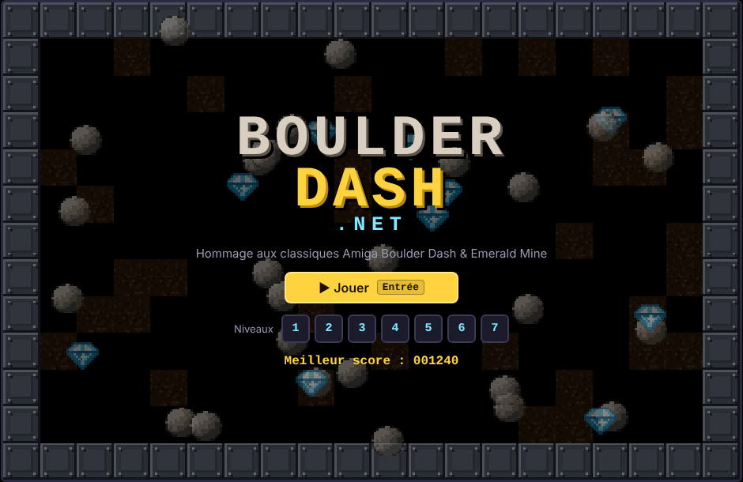
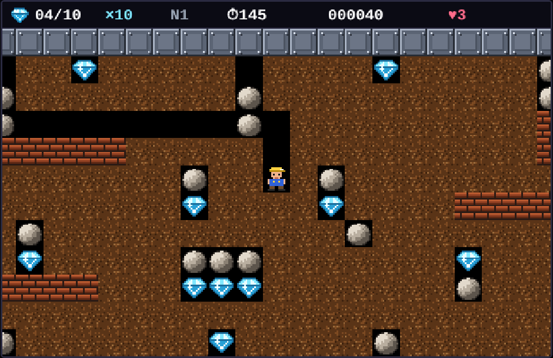
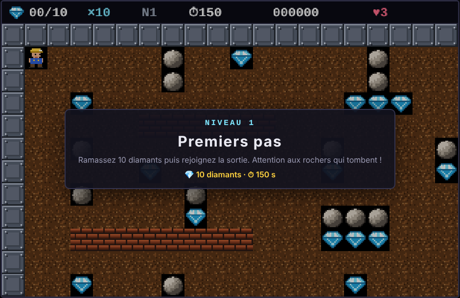
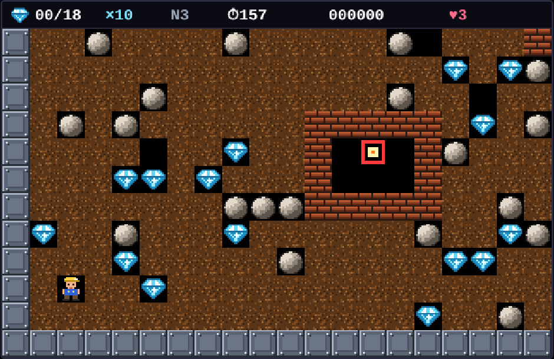
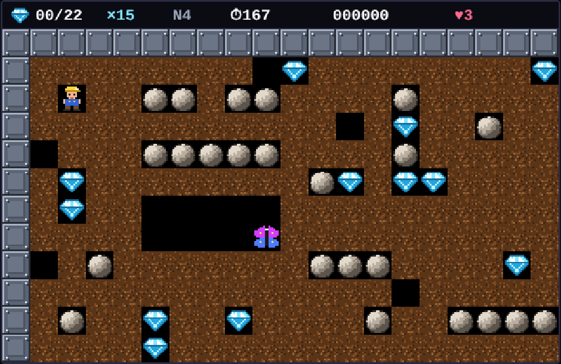

# BoulderDashNet

🇬🇧 [English](README.md) · 🇫🇷 **Français**

Hommage en **.NET 10 / Blazor WebAssembly** aux classiques Amiga **Boulder Dash** et **Emerald Mine**.
Toute la logique du jeu est écrite en C#. Elle tourne dans le navigateur via WebAssembly, et le rendu se fait sur un `<canvas>` en pixel art généré par le code (aucun asset externe).

> Le jeu est disponible en français et en anglais : boutons drapeaux au-dessus de l'écran de jeu. La langue est détectée depuis le navigateur à la première visite, puis mémorisée.

<p align="center">
  
</p>

<table>
  <tr>
    <td></td>
    <td></td>
  </tr>
  <tr>
    <td align="center"><sub>Niveau 1 : on creuse et on ramasse les diamants</sub></td>
    <td align="center"><sub>Présentation d'un niveau</sub></td>
  </tr>
  <tr>
    <td></td>
    <td></td>
  </tr>
  <tr>
    <td align="center"><sub>Niveau 3 : une luciole enfermée dans sa boîte de briques</sub></td>
    <td align="center"><sub>Niveau 4 : un papillon sous une rangée de rochers</sub></td>
  </tr>
</table>

## Lancer le jeu

```powershell
dotnet run --project src/BoulderDashNet.Server
```

Ouvrez ensuite <http://localhost:5046>. L'hôte ASP.NET Core sert le jeu et tient un journal des connexions (dossier `logs/`, un fichier par jour).

Pour lancer seulement le client WebAssembly, sans l'hôte : `dotnet run --project src/BoulderDashNet.Web` (<http://localhost:5018>).

Lancer les tests :

```powershell
dotnet test
```

Publier :

```powershell
# Hôte ASP.NET Core + jeu (journal des connexions inclus)
dotnet publish src/BoulderDashNet.Server -c Release -o publish

# ou site 100 % statique, pour n'importe quel serveur web (IIS, nginx, Web Station…)
dotnet publish src/BoulderDashNet.Web -c Release -o publish-static   # le site est dans publish-static/wwwroot
```

### Journal des connexions

Chaque chargement de page ajoute une ligne à `logs/access-AAAA-MM-JJ.log` : date, IP du client, chemin, code HTTP, référent et navigateur. Derrière un reverse proxy, l'IP réelle est lue dans `X-Forwarded-For`. Réglages dans `appsettings.json`, section `AccessLog`, ou par variables d'environnement :

| Variable | Défaut | Rôle |
|---|---|---|
| `AccessLog__Enabled` | `true` | Active le journal |
| `AccessLog__Directory` | `logs` | Dossier des fichiers |
| `AccessLog__RetentionDays` | `90` | Jours de conservation (`0` = illimité) |

### Hall of Fame

En fin de partie (game over ou victoire), le joueur peut inscrire son pseudo au Hall of Fame. Le pseudo est mémorisé dans un cookie (`bdnet_pseudo`, 1 an). Les scores sont enregistrés sur le serveur dans `data/highscores.json` (meilleur score par joueur, 100 premiers) et tout le monde voit le classement depuis l'écran d'accueil.

- API : `GET /api/scores?top=10`, `POST /api/scores` `{ "name", "score", "level" }`
- Pseudo : 1 à 16 lettres, chiffres, espaces ou `- _ . ' !`
- Anti-triche de base : un score supérieur à ce que permet le niveau atteint est refusé, et les envois sont limités à 6 par minute et par IP. Le jeu tourne dans le navigateur, donc un tricheur déterminé peut encore forger un score plausible ; il suffit alors de corriger `highscores.json`.
- Réglages : `HighScores__File` (défaut `data/highscores.json`), `HighScores__MaxEntries` (défaut `100`).

L'endpoint `/health` répond `{"status":"ok"}` (supervision).

## Commandes

| Touche | Action |
|---|---|
| Flèches / ZQSD (WASD) | Déplacer le mineur |
| Espace (ou Ctrl) + direction | Creuser / ramasser **sans bouger** |
| Échap / P | Pause |
| R (en pause) | Abandonner le niveau (perd une vie) |
| Entrée | Commencer / passer l'intro |
| M | Couper / remettre les bruitages |
| N | Musique 8 bits de l'écran d'accueil (désactivée par défaut, aussi via le bouton 🎵) |

Sur un écran tactile, une croix directionnelle s'affiche automatiquement.

## Règles

- Ramassez le nombre de diamants demandé : la sortie s'ouvre (l'écran clignote). Rejoignez-la avant la fin du chrono.
- Un rocher ou un diamant **qui tombe** est mortel. Ceux qui reposent ne le sont pas, mais ils roulent sur les rochers, les diamants et les murs de briques.
- Vous pouvez pousser horizontalement un rocher si la case derrière lui est vide.
- **Luciole** (carré orange) : elle longe les parois par la gauche et explose à votre contact. Écrasez-la sous un rocher.
- **Papillon** (ailes violettes) : il longe les parois par la droite. Écrasé, il se transforme en 9 diamants.
- **Amibe** (verte) : elle grandit. Enfermée, elle se change en diamants ; trop grosse, elle se pétrifie en rochers. Elle fait exploser les ennemis qu'elle touche.
- **Mur magique** : activé par un objet qui tombe dessus, il transforme pendant un temps limité les rochers en diamants (et inversement).
- Le temps restant en fin de niveau s'ajoute au score. Vous gagnez une vie tous les 500 points.

Le niveau atteint et le meilleur score sont mémorisés dans le navigateur (localStorage).

## Structure

```
BoulderDashNet.sln
src/
  BoulderDashNet.Core/     moteur du jeu (C# pur, sans dépendance)
    Tiles.cs               types de cases, directions, événements, codes de rendu
    Cave.cs                physique et règles (balayage de la grille à chaque tick)
    GameSession.cs         partie : niveaux, vies, score, chrono, caméra
    CaveDefinition.cs      définition d'une caverne + CaveBuilder (carte ASCII ou procédurale)
    Levels.cs              les 7 cavernes
  BoulderDashNet.Server/   hôte ASP.NET Core : sert le jeu, journal des connexions, /health
  BoulderDashNet.Web/      application Blazor WebAssembly
    Pages/Home.razor(.cs)  menus et écrans (HTML) + pont avec le moteur
    wwwroot/js/game.js     rendu canvas, sprites, clavier/tactile, sons WebAudio
    wwwroot/css/app.css
tests/
  BoulderDashNet.Tests/    tests xUnit du moteur et des niveaux
```

### Boucle de jeu

`game.js` appelle `Home.Frame(dt, direction, ...)` à chaque `requestAnimationFrame`. Le moteur C# avance de 0, 1 ou plusieurs ticks (environ 7,7 par seconde, réglable par niveau via `TickSeconds`). Il renvoie ensuite un `byte[]` composé d'un en-tête (état, caméra, HUD, événements sonores) et d'un code de sprite par case. Le JavaScript ne fait que dessiner.

### Ajouter un niveau

Dans `Levels.cs`, ajoutez une `CaveDefinition` :

- soit avec une carte ASCII (`Map`). Légende : `W` acier, `w` briques, `.` terre, espace vide, `r` rocher, `d` diamant, `P` joueur, `X` sortie, `q` luciole, `B` papillon, `a` amibe, `m` mur magique ;
- soit avec une construction procédurale (`Build`) façon Boulder Dash : `RandomFill`, `Line`, `Box`, `FillRect`, `Set`…

Le test `Every_level_is_well_formed` vérifie que chaque niveau a un joueur, une sortie et assez de diamants.

## Crédits

Projet de fan. Les niveaux, les sprites et les sons sont des créations originales inspirées de Boulder Dash (First Star Software, 1984) et d'Emerald Mine (Kingsoft, 1987). Ce projet n'est affilié à aucun de ces éditeurs.
